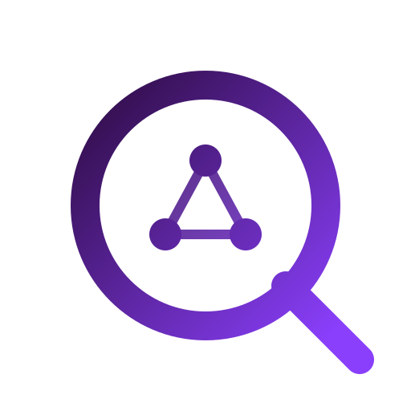

<p align="center">
  
</p>

<h1 align="center">Qayd</h1>

<p align="center">A Unified Semantic Architecture for Heterogeneous Constraint Solving.</p>

<p align="center">
  <a href="https://sohaibafifi.github.io/qayd/">Website</a> ·
  <a href="examples/python/">Python examples</a> ·
  <a href="bench/README.md">Benchmarks</a>
</p>

## What It Is

Qayd provides one semantic modeling layer for finite-domain, collection,
routing, packing, and scheduling problems. Rust, Python, XCSP3, FlatZinc,
DIMACS CNF, and OPB inputs use the same solve path.

The solver can select exact search or local search according to the model and
the request. Limits, cancellation, result statuses, and final solution checks
are owned by one orchestrator.

Priority order: correct, simple, fast.


## Capabilities

- **Finite-domain modeling.** Integer and Boolean variables, finite sets,
  expressions, linear constraints, tables, automata, MDDs, and global
  constraints such as `allDifferent`, `element`, `circuit`, `cumulative`, and
  `noOverlap`.
- **Exact search and learning.** Propagation, branch-and-bound, Lazy Clause
  Generation, assumptions, custom search phases, restarts, and parallel search.
- **Collections.** Ordered lists and unordered sets support partitions,
  reductions, scans, windows, lexicographic objectives, fixed-point terms, and
  exact or local-search execution. This surface remains experimental.
- **Routing and packing.** Typed models and examples cover TSP, CVRP, VRPTW,
  PDPTW, TOP, heterogeneous fleets, bin packing, and assignment problems.
- **Scheduling.** Intervals, optional tasks, alternatives, precedences,
  cumulative resources, setup sequences, calendars, state functions, and
  makespan objectives support compact exact models and larger local-search
  models.
- **Control and diagnostics.** Reproducible seeds, time and memory limits,
  conflict and iteration budgets, external cancellation, progress events,
  reusable solve sessions, assumptions, and exact MUS extraction.
- **Data and experiments.** Typed readers cover CVRPLIB, Solomon and
  Gehring-Homberger, JSPLIB, and PSPLIB. Runnable examples include a broad
  CSPLib catalog, while `bench/` provides provenance-aware campaigns and
  independent validators.

## Interfaces

| Interface | Purpose |
| --- | --- |
| Rust crate | Build `Model` and solve it through `qayd::solve` |
| Python package | Typed integer, collection, routing, packing, and scheduling models |
| `qayd` | XCSP3 Core CLI, including compressed inputs and `--core` MUS extraction |
| `qayd-fzn` | Beta FlatZinc driver and MiniZinc bundle |
| `qayd-sat` | Beta DIMACS CNF frontend |
| `qayd-pb` | Beta OPB pseudo-Boolean frontend |

Each frontend exposes the subset appropriate to its input format. They share
the orchestration and result contract, not an identical constraint surface.

## Build And Test

Build and validate the Rust workspace:

```bash
cargo build --workspace
cargo test --workspace
cargo clippy --workspace --all-targets -- -D warnings
```

Build the Python extension and run its tests with Python 3.11 or newer
(CI uses Python 3.12). The development group provides Maturin and pytest:

```bash
uv sync --locked --no-install-project
uv run --no-sync maturin develop --profile pyext --uv
uv run --no-sync python -m pytest tests/python
```

## Rust API

The canonical Rust entry point accepts a semantic package and a solve request:

```rust
use qayd::model::{Constraint, Model, ModelPackage, Relation};
use qayd::orchestrator::{IgnoreEvents, SolveRequest};

let mut model = Model::new();
let value = model.int_range(0, 9);
model.add_constraint(Constraint::Linear {
    terms: vec![(1, value)],
    relation: Relation::Ge,
    rhs: 4,
});

let result = qayd::solve(
    &ModelPackage::new(model),
    &SolveRequest::default(),
    &mut IgnoreEvents,
)
.expect("the model is valid and supported");

assert_eq!(result.status().as_str(), "SATISFIABLE");
```

`qayd::solve_search` keeps the lower-level search API available for code that
works directly with solver internals.

## Command Line

Solve an XCSP3 instance with a reproducible parallel run:

```bash
cargo run --bin qayd -- -t 60 -p 4 --seed 0 path/to/instance.xml
```

Use `--help` on `qayd`, `qayd-fzn`, `qayd-sat`, or `qayd-pb` for the controls
available to that frontend.

## Python Examples

After building the Python extension, the examples run directly from the
repository:

```bash
uv run examples/python/optimization/search_policy.py
uv run examples/python/routing/api/vrp.py --time-limit 2
uv run examples/python/scheduling/api/intervals.py
uv run python -m examples.python.csplib list
```

The examples are grouped under `routing/`, `scheduling/`, `packing/`,
`optimization/`, `mus/`, and `csplib/`. Routing and scheduling include both
low-level native models and higher-level typed APIs.

## Optional LP Integration

Amthal is a private, optional LP backend available only
through the separate [local integration](integrations/amthal/README.md).
That integration requires authorized access to a compatible Amthal checkout.

With Amthal checked out at `../amthal`, run from the Qayd repository root:

```bash
cargo build --release --manifest-path integrations/amthal/Cargo.toml
integrations/amthal/target/release/qayd your-instance.xml.lzma -v -t 180
```

This manifest enables LP by default; `--all-features` is unnecessary. For the
Python extension with LP, use:

```bash
uv run maturin develop --manifest-path integrations/amthal/Cargo.toml --profile pyext --features python
```

Ordinary builds use `cargo build --release` and require no Amthal checkout.
The public workspace's `--all-features` does not select the private LP backend.

## License

MIT
